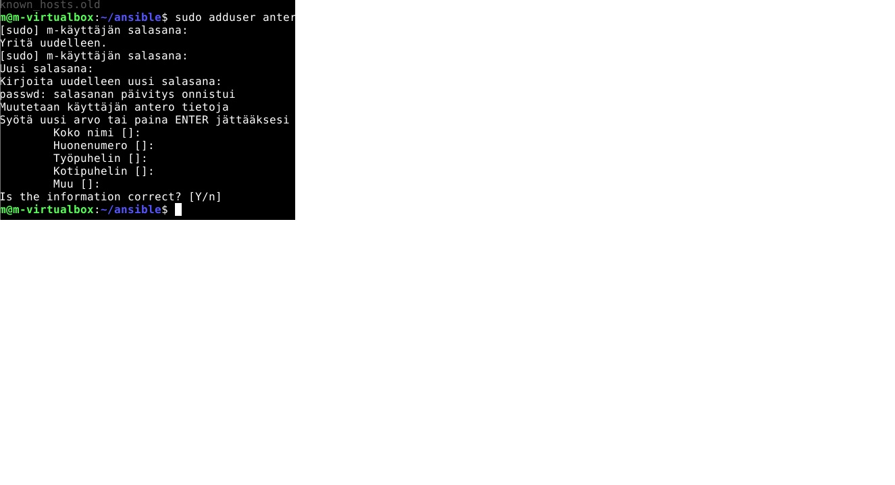
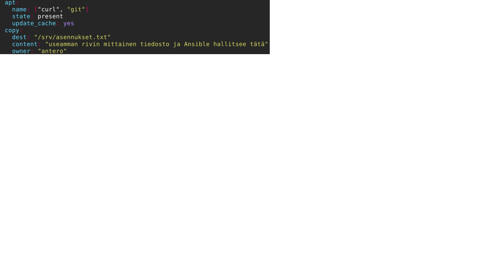
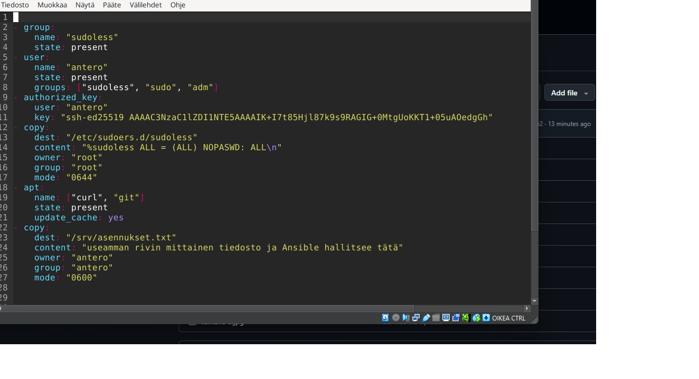

# h1 Voileipä
## tehtävä X

Karvinen 2026: Sudo without password

*Sudo-komennon salasanakyselyn voi poistaa muokkaamalla tiedostoa
/etc/sudoers.d/sudoless
*Muokataan editorilla visudo joka tarkistaa virheet ennen tallennusta
*säännöksi tulee %sudoless ALL = (ALL) NOPASSWD: ALL
*Säännöt päivittyvät vasta kun käyttäjä kirjautuu ulos ja takaisin sisään. Sitä ennen vanhat oikeudet voi nollata testausta varten komennolla sudo -k
* Sudo visudo kuullostaa järkevältä vaihtoehdolta, että kone pysyy käyttökuntoisena ja ei tule rikotuksi muokkaamalla ilman testejä.

Munroe 2006: xkcd 149: Sandwitch

*Sarjakuvassa saa käyttämällä sudo komentoa leipää, ilman ei.

Karvinen 2026: Passwordless Sudo with Ansible

*Ansiblella usealle koneelle sudoles toiminto jäyttöön
*Ansible voi toimia pääkäyttäjänä kohdepalvelimilla ilman salasanan syöttöä


Ansible doc
*siellä ohjeita sovelluksen omista toiminnoista.
*toimii kehittäjän apuna työskennellessä.


** tehtävä a
Seurattu vaihe vaiheelta ohjeistusta ja luotu järjestelmään uusi ryhmä sekä käyttäjä käsin pääteikkunassa seuraavilla komennoilla:
```bash
sudo adduser antero
sudo groupadd sudoless
sudo adduser antero sudoless
```
https://github.com/Macobra87/h1-Hei-Ansiblen-maailma/blob/main/antero.jpg



** tehtävä b
Jatkettu ohjeiden seuraamista ja visudoa käyttäen tehty vaaditut asetukset ryhmälle:
```bash
sudo visudo /etc/sudoers.d/sudoless
```
Tiedostoon määritettiin sääntö:
`%sudoless ALL = (ALL) NOPASSWD: ALL`

Säännön selitys osioittain:
* **%sudoless** Percent "%" means group
* **ALL** All computers
* **=** Literal equals "=", a separator
* **(ALL)** Runas: may become any user, including root
* **NOPASSWD** Tag: don't prompt for password
* **:** Literal colon ":", a separator
* **ALL** All commands permitted

** tehtävät a & b testaus
Määritetty SSH-avaimet kuntoon ja testattu kirjautumista anterona sekä salasanatonta sudoa seuraavilla komennoilla:
```bash
cat /home/m/.ssh/id_ed25519.pub
ssh antero@localhost
sudo echo "see you at TeroKarvinen.com"
```
Komento tulosti tekstin suoraan ilman salasanakyselyä, joten salasanaton sudo ja tunnus toimivat täydellisesti.


** tehtävä c

Asennettu Ansible-playbookilla/roolilla kaksi pakettia: `curl` ja `git`.
Tarkistettu onnistuivatko asennukset katsomalla ohjelmistojen versiot:
* `git --version` -> Git versio oli 2.47.3
* `curl --version` -> Curl versio oli 8.14.1
https://github.com/Macobra87/h1-Hei-Ansiblen-maailma/blob/main/Asennus.jpg


** tehtävä d
Siirretty manuaalisesti testatut konfiguraatiot IaC-automaatioon (Infrastructure as Code). Luotiin Ansible-roolirakenne komennolla:
```bash
mkdir -p roles/antero/tasks
```

Tehtävät kirjoitettiin roolin tiedostoon `roles/antero/tasks/main.yml` käyttäen `micro`-editoria (`micro roles/antero/tasks/main.yml`):

```yaml
- group:
    name: "sudoless"
    state: present
- user:
    name: "antero"
    state: present
    groups: ["sudoless", "sudo", "adm"]
- authorized_key:
    user: "antero"
    key: "ssh-ed25519 AAAAC3NzaC1lZDI1NTE5AAAAIK+I7t85Hjl87k9s9RAGIG+0MtgUoKKT1+05uA0edgGh m@m-virtualbox"
- copy:
    dest: "/etc/sudoers.d/sudoless"
    content: "%sudoless ALL = (ALL) NOPASSWD: ALL\n"
    owner: "root"
    group: "root"
    mode: "0644"
- apt:
    name: ["curl", "git"]
    state: present
    update_cache: yes
- copy:
    dest: "/srv/asennukset.txt"
    content: "useamman rivin mittainen tiedosto ja Ansible hallitsee tätä"
    owner: "antero"
    group: "antero"
    mode: "0600"
```https://github.com/Macobra87/h1-Hei-Ansiblen-maailma/blob/main/site.yml.jpg


Päänäkymän playbook `site.yml` luotiin komennolla `micro site.yml`:
```yaml
---
- hosts: localhost
  become: true
  roles: ["antero"]
```

Automaatio ajettiin onnistuneesti läpi päänäkymästä komennolla:
```bash
ansible-playbook -i hosts.ini site.yml -K
```

Lopputulos ja tiedoston luonti tarkistettiin päätteessä komennolla:
```bash
ls -l /srv/asennukset.txt
```

### Tiedosto-oikeuksien symbolisen muodon selitys

Tehtävässä d käytetty oktaaliluku `"0600"` tarkoittaa symbolisessa muodossa **`-rw-------`**. 
Esimerkkinä annettu muoto `"-rwxr--r--"` tarkoittaa laajempaa lukuoikeutta.

Kirjainyhdistelmät jaetaan kolmen merkin ryhmiin (luetaan vasemmalta oikealle):
1. **Ensimmäinen merkki (`-`):** Kertoo tiedostotyypin (tavallinen tiedosto).
2. **Ensimmäiset 3 kirjainta (Käyttäjä/Omistaja):** `rw-` (tai esimerkin `rwx`). Tarkoittaa oikeuksia lukea (*Read*), kirjoittaa/muokata (*Write*) ja suorittaa (*Execute*). Meidän koodissamme omistaja `antero` saa lukea ja muokata tiedostoa.
3. **Seuraavat 3 kirjainta (Omistava ryhmä):** Meidän koodissamme `---` (ryhmällä ei mitään oikeuksia). Esimerkissä `r--` tarkoittaa, että ryhmän jäsenet saavat vain lukea tiedostoa.
4. **Viimeiset 3 kirjainta (Muut käyttäjät / "others"):** Meidän koodissamme `---` (muilla ei mitään oikeuksia). Esimerkissä `r--` tarkoittaa, että kaikilla muillakin järjestelmän käyttäjillä on lukuoikeus.
https://github.com/Macobra87/h1-Hei-Ansiblen-maailma/blob/main/Readwrite%20antero.jpg
https://github.com/Macobra87/h1-Hei-Ansiblen-maailma/blob/main/teht%C3%A4v%C3%A4%20d.jpg


Lähteet 
*Ansible- doc
*Karvinen 2026: Sudo without password
*Munroe 2006: xkcd 149: Sandwitch
*Karvinen 2026: Passwordless Sudo with Ansible
*Kurssin luento 29.10.2026


Muokattu tehtävää 4.11 yritetty onnistua kuvien lisäämisessä
