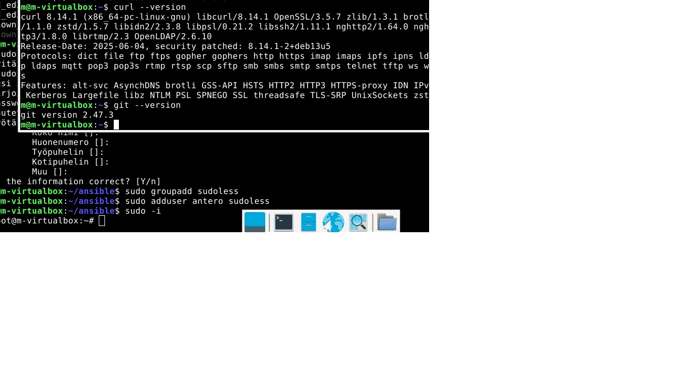
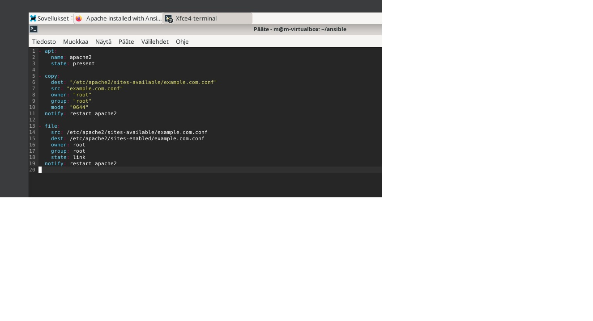
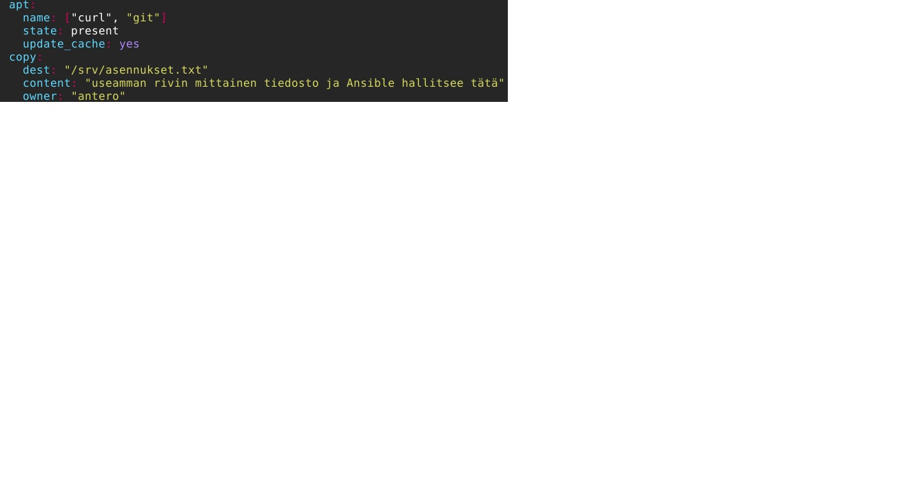

# h3 Demoni
## tehtävä X

Karvinen 2026: Apache installed with Ansible - quick notes:
*Apachen automaati asennukseen ohjeet.
*apt komennolla asennus copy komennolla verkko sivu josta tiedosto.
*Muistuttaa, että `become: true` on välttämätön, koska järjestelmätason palveluiden asennus vaatii pääkäyttäjän oikeudet.
*huomio automatisointi helpottaa usealle koneelle asennusta saman aikaisesti.


Ansible Community Documentation: Handlers: running operations on change
 *Handlers: running operations on change (johdantokappale pääotsikon alta)
 *Notifying handlers
  **Johdanto ja Notifying handlers:** Handlersit ovat erityisiä tehtäviä, jotka suoritetaan vain silloin, kun jokin toinen tehtävä ilmoittaa muutoksesta (`notify`).
* Niitä käytetään tyypillisesti palveluiden käynnistämiseen uudelleen (restart) silloin, kun niiden konfiguraatiotiedostoja on muutettu.
* Handlersit ajetaan automaattisesti vasta aivan Playbookin loppupuolella, jotta palvelinta ei turhaan käynnistetä uudelleen useita kertoja kesken ajon.
* huomio hidastais toimintaa jos kokoajan boottailisi


**'ansible-doc service'**
* **MODULE-johdanto:** Moduuli, jota käytetään taustapalveluiden (daemonien), kuten Apachen tai Nginxin, tilan ja käynnistyksen hallintaan kohdekoneilla.
* **enabled:** Määrittää, käynnistyykö palvelu automaattisesti aina kun tietokone käynnistetään (`yes`/`no`).
* **name:** Hallittavan palvelun nimi (esim. `apache2` tai `nginx`).
* **state:** Palvelun haluttu tila (`started` = käynnissä, `stopped` = sammutettu, `restarted` = käynnistetty uudelleen).
* *Oma huomio:* Ohjeen esimerkeissä näytetään hyvin, miten palvelun voi varmistaa pysyvän käynnissä ja samalla ottaa sen käyttöön järjestelmän käynnistyksessä yhdellä lyhyellä koodinpätkällä.


** tehtävä a) Apassi
Asennettiin Apache2-verkkopalvelin manuaalisesti järjestelmään ja varmistettiin, että testisivu latautuu tavallisen käyttäjän kotihakemistosta.

1. Asennettiin Apache2-paketti järjestelmän omalla paketinhallinnalla:
```bash
sudo apt update
sudo apt install -y apache2
```

2. Koska koneella oli jo valmiina aiemmista harjoituksista luotu `publicsite/index.html` -tiedosto, muokattiin sen tekstisisältöä ilman sudo-oikeuksia komennolla:
```bash
echo "<h1>Apache hoidettu kuntoon ja nyt testaillaan.</h1>" > /home/m/publicsite/index.html
```

3. Säädettiin hakemisto- ja tiedosto-oikeudet kuntoon (`chmod`), jotta verkkopalvelimen `www-data`-käyttäjä saa luvan lukea sivun sisällön:
```bash
chmod ugo+x /home/m/
chmod ugo+x /home/m/publicsite/
chmod ugo+r /home/m/publicsite/index.html
```


** tehtävä b) Moottorix
Asennettiin Nginx-verkkopalvelin manuaalisesti. Koska kaksi demonia ei voi kuunnella samaa porttia (80) samanaikaisesti, suoritettiin portin tyhjennys ja varmistettiin, että sivu latautuu Nginxin kautta käyttäjän kotihakemistosta.

1. Yritettäessä käynnistää Nginxiä ilmeni virheilmoitus, koska aiemmin automatisoitu Apache2 varasi porttia 80. Vapautettiin portti 80 kaikista taustaprosesseista ja käynnistettiin Nginx seuraavilla komennoilla:
```bash
sudo fuser -k 80/tcp
sudo systemctl start nginx
```

2. Muokattiin Nginxin oletuskonfiguraatiota tiedostossa `/etc/nginx/sites-available/default` käyttäen `micro`-editoria:
```bash
sudo micro /etc/nginx/sites-available/default
```

Etsittiin tiedostosta `root /var/www/html;` -rivi (noin riviltä 40) ja muutettiin se osoittamaan tavallisen käyttäjän kotisivukansioon:
```text
root /home/m/publicsite;
```

3. Testattiin konfiguraation oikeellisuus, käynnistettiin palvelu uudelleen ja todennettiin onnistuminen selaimella osoitteessa http://localhost:
```bash
sudo nginx -t
sudo systemctl restart nginx
```

Testikomento `sudo nginx -t` antoi onnistuneen tuloksen (`syntax is ok`, `test is successful`). Selaimella varmistettiin, että sivu latautuu nyt onnistuneesti suoraan Nginxin tarjoamana ja näyttää kotihakemistosta lukemansa tekstin: "Apache hoidettu kuntoon ja nyt testaillaan."


** tehtävä c) Automoottorix

** tehtävä c) Automoottorix
Automatisoitiin verkkopalvelimen asennus luomalla Ansibleen Karvisen (2026) ohjeiden mukainen Package-File-Service -rakenteinen rooli (`roles/nginx/`). Koodi kirjoitettiin manuaalisesti kahden koneen välillä.

1. Luotiin roolirakenne Nginx-automaatiota varten komennolla:
```bash
mkdir -p roles/nginx/tasks roles/nginx/handlers roles/nginx/files
```

2. Kirjoitettiin tehtävätiedosto `roles/nginx/tasks/main.yml`, johon lisättiin aluksi itsenäinen palvelun sammutus Apachelle, jotta portti 80 vapautuu Nginxille:
```yaml
- service:
    name: apache2
    state: stopped

- apt:
    name: nginx
    state: present

- copy:
    dest: /etc/nginx/sites-available/default
    src: default
    owner: root
    group: root
    mode: "0644"
  notify: restart nginx
```

3. Määritettiin päänäkymän playbook `site.yml` ketjuttamaan kaikki kurssilla tähän asti tehdyt kolme roolia suoritettavaksi peräkkäin siistissä listassa:
```yaml
---
- hosts: localhost
  become: true
  roles: ["antero", "apache2", "nginx"]
```

4. Ajettuja playbookia komennolla `ansible-playbook -i hosts.ini site.yml -K` ilmeni syntaksivirhe Nginx-roolin kohdalla. Järjestelmä suoritti onnistuneesti `antero`- ja `apache2`-roolit, mutta pysähtyi Nginxin kohdalla punaiseen virheilmoitukseen:
`[ERROR]: Task failed: ... Origin: /home/m/ansible/roles/nginx/tasks/main.yml:9:3`
Virhe ilmoitti ongelman olevan rivillä 9, sarakkeessa 3 (`column 3`), jossa sijaitsee `- copy:` -tehtävän aloitus. Vaikka koodi näytti editorissa suoralta ja viiva oli vasemmassa laidassa, näkymätön sarkainmerkki (Tab) tai tyhjän rivin piilomerkki aiheutti YML-rakenteessa tulkintavirheen, johon automaation testaus tällä erää päättyi.




## Lähteet
* Karvinen 2026: Apache installed with Ansible - quick notes. URL: https://terokarvinen.com
* Ansible Community Documentation: Handlers: running operations on change. URL: https://ansible.com
* Järjestelmän manuaalisivut: `ansible-doc service`
* Kurssin oppitunnit ja käytännön harjoitukset (2026)
* Apuna käytetty myös geminiä. Ymlien läpikäyntiä ja omia kirjoitusvirheitä etsiessä
