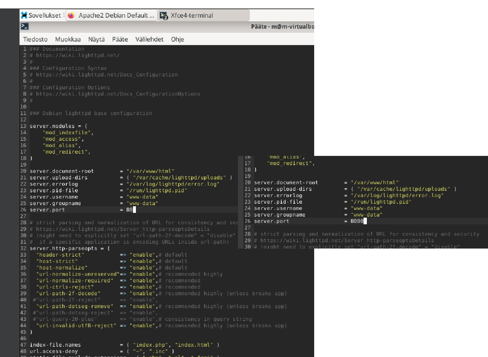
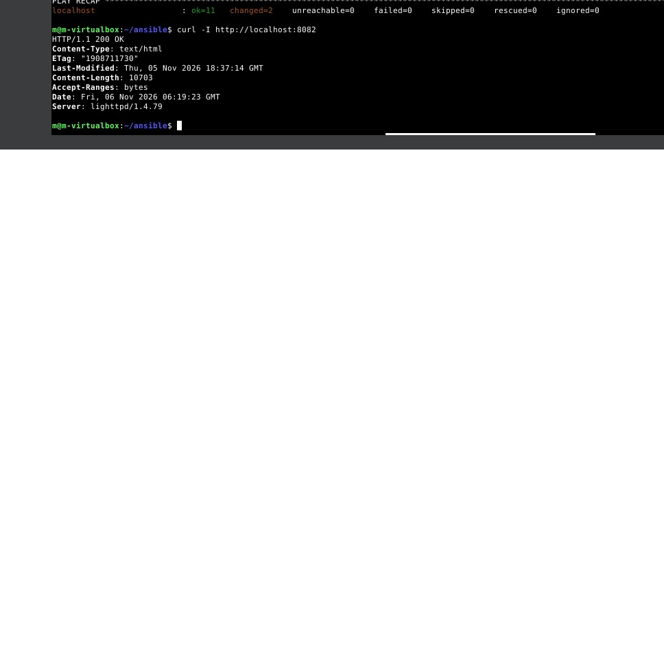

# h4 Pizza Fantasia
## tehtävä X
Karvinen 2023: Configuration Management of Distributed Systems over Unreliable and Hostile Networks (pdf, ̣mirrors: local, archive.org), vain nämä kohdat:
4.12.1 Size and Complexity of Some DSLs (112. Ominaisuuksien määrä.)
*DSL(Domain Specific Languages) Ominaisuuksia löytyy enemmänkin kuin tarpeeksi
*Saltissa +500, Puppetissa +100
*Näihin vielä työkalujen omat erikoisuuspiirteet lisäksi.
Oma miete: Määrät tuntuvat valtavilta ja pistää miettimään onko mahdollista oppia kaikkea, mutta loppupeleissä käytetään vain pientä prosenttia ominaisuuksista.

4.12.2 Use of DSL Functions in Case Configuration (112-115. Mitä oikeasti käytetään.)
*Vain harvoja käytetään oikeasti. Muut ovat vain ylimääräistä
*Share n Type Commands
  20% 475 C case
  19% 429 F file
  10% 234 F package
  6% 136 F exec
  3% 75 F service
  3% 71 I fw::rules
  3% 67 I registry_value
  3% 66 C if
  3% 63 I registry::value
  3% 62 C class
  2% 52 C anchor
  2% 41 I packages::pkgdmg
  
  *Most used functions (F) and control structures (C) and internally defined (I) in Mozilla Release
Engineering Puppet manifests.
Oma miete: Miksi pitää olla näin älytön määrä kaikkea, kun alle 15 riittää kattamaan 77 prosenttia käytetyistä.

4.12.3.1 Dependencies Between Main Functions (115-117. Tärkeimmät rakennuspalikat.)

*Yleisimpiin toimintoihin kuuluvat paketti-tiedosto-palvelu (package-file-service), käyttäjä (user), ryhmä (group) ja komennon suoritus (exec).
*Category Functions
Daemon setup package, file, service
App setup package, file
User management user, group
File manipulation file, directory, symlink
*oma miete: Hallinta tuntuu kuitenkin toimivan melko vähäisillä toiminnoilla.

## Tehtävä A

Aloitettu tehtävän tekeminen pysäyttämällä (sudo systemctl stop apache2 nginx) ja disabloiimalla (sudo systemctl disable apache2 nginx). Tämän jälkeen tarkastin apache2 ja nginx tilan (sudo systemctl status apache2 ja sudo systemctl status nginx).

• sudo systemctl stop apache2 nginx: Pysäyttää käynnissä olevat Apache- ja Nginx-verkkopalvelimet pääkäyttäjän oikeuksilla, jotta ne eivät varaa verkkoporttia 80.
• sudo systemctl disable apache2 nginx: Poistaa Apachen ja Nginxin automaattisen käynnistyksen käytöstä, jotta ne eivät käynnisty uudelleen tietokoneen uudelleenkäynnistyksen yhteydessä.
• sudo systemctl status apache2 (ja nginx): Tarkistaa palveluiden ajantasaisen tilan ja varmistaa, että molemmat ovat varmasti sammuneet (inactive).
Sitten pystyi suorittamaan asennuksen Lighttpd demoniin. Aloitin sudo apt-get update.
sitten vuorossa oli sudo apt-get install -y lighttpd (en tiedä kauheasti demoneista joten kysyin google geminiltä (Gemini 4 Hydrogen), jonkun sopivan demonin asennettavaksi. Manuaalinen asennus onnistui
• sudo apt-get update: Päivittää järjestelmän pakettiluettelot ajan tasalle ennen uusien ohjelmistojen asentamista.
• sudo apt-get install -y lighttpd: Asentaa kevyen lighttpd-verkkopalvelindemonin järjestelmään ilman erillisiä vahvistuskysymyksiä (-y).
Testasin demonin toiminnan komennolla curl -I http://localhost, joka palautti tilakoodin HTTP/1.1 200 OK 

• curl -I http://localhost: Hakee paikallisen verkkopalvelimen HTTP-vastausotsikot ja todistaa palvelimen olevan toiminnassa (HTTP/1.1 200 OK).

Tämän A tehtävän lähteenä kertasin edellisiä  tehtäviä ja omaa H3Demoni.md ja Karvinen 2026: Apache installed with Ansible. Demoniksi valitsin kevyen lighttpd -palvelimen teoälynperusteella (Google Gemini 2026).
## Tehtävä B

Aloitin tehtävän luomalla Ansible-roolin kansiorakenteen (mkdir -p roles/lighttpd/{files,handlers,tasks}) ja kopioimalla toimivan oletusasetustiedoston roolin käyttöön (cp /etc/lighttpd/lighttpd.conf roles/lighttpd/files/lighttpd.conf).
• mkdir -p roles/lighttpd/{files,handlers,tasks}: Luo Ansible-roolille tarvittavat alihakemistot asetustiedostoille, handlereille ja tehtäville yhdellä komennolla. 

* **cp /etc/lighttpd/lighttpd.conf roles/lighttpd/files/lighttpd.conf**: Kopioi alkuperäisen asetustiedoston talteen roolin files-kansioon, jotta Ansible voi jakaa sen kohdekoneelle.

Tämän jälkeen loin roolin tehtävätiedoston (micro roles/lighttpd/tasks/main.yml), johon määrittelin package–file–service-rakenteen (paketin asennus, asetustiedoston kopiointi ja palvelun käynnistys), sekä handler-tiedoston (micro roles/lighttpd/handlers/main.yml) palvelun uudelleenkäynnistystä varten. Lisäksi päivitin päätiedoston (micro site.yml), jotta se ajaa roolit ["antero", "lighttpd"].
• micro roles/lighttpd/tasks/main.yml: Määrittelee Ansiblen suoritettavat tehtävät, joilla varmistetaan lighttpd-paketin asennus, asetustiedoston kopiointi ja palvelun päälläolo.
• micro roles/lighttpd/handlers/main.yml: Määrittelee uudelleenkäynnistystoiminnon, jonka Ansible suorittaa automaattisesti vain silloin, kun asetustiedosto muuttuu.
• micro site.yml: Määrittää kohdepalvelimen (localhost) ja listaa sille ajettavat roolit (antero ja lighttpd).
Lopuksi ajoin playbookin komennolla ansible-playbook -i hosts.ini site.yml -K. Ensimmäisellä ajolla apt-välimuistin päivitys epäonnistui, joten poistin update_cache: true -rivin tehtävätiedostosta ja ajoin playbookin uudelleen. Ajo onnistui virheittä (ok=10, changed=0, failed=0), mikä osoittaa konfiguraation olevan idempotentti ja valmiin.
• ansible-playbook -i hosts.ini site.yml -K: Suorittaa määritellyn Ansible-playbookin kohdekoneelle ja kysyy pääkäyttäjän sudo-salasanan (-K) ennen muutosten tekemistä.

Tehtävässä B hyödynsin aiempaa rakentamaani ~/ansible ympäristöäni sekä salasanatonta antero -tunnusta. Apunani oli myös aikaisempi H2voileipä.md, ja lisäksi h3Demoni.md ja Ansible Community Documentation 2026.

## Tehtävä C

Aloitin tehtävän muokkaamalla herrakoneella olevaa lighttpd-demonin asetustiedostoa (micro roles/lighttpd/files/lighttpd.conf) ja vaihtamalla kuunneltavan verkkoportin oletusarvosta 80 porttiin 8082 (server.port = 8082).
• micro roles/lighttpd/files/lighttpd.conf: Avaa herrakoneella sijaitsevan asetustiedoston muokattavaksi, jotta palvelimen kuunteluportti voidaan vaihtaa.
Tämän jälkeen ajoin Ansible-playbookin uudestaan komennolla ansible-playbook -i hosts.ini site.yml -K. Aiemmilla yrityksillä handlerin käynnistys epäonnistui pienen kirjoitusvirheen vuoksi, mutta korjattuani sen ajo onnistui virheittä (ok=11, changed=2, failed=0). Tulosteesta näkyi, että Ansible kopioi päivitetyn asetustiedoston kohdekoneelle ja suoritti automaattisesti lighttpd restart -handlerin palvelun uudelleenkäynnistämiseksi.
• ansible-playbook -i hosts.ini site.yml -K: Suorittaa playbookin uudestaan, havaitsee asetustiedoston muutoksen (changed=2) ja käynnistää palvelun uudelleen handlerin avulla.
Lopuksi osoitin asetusten tulleen käyttöön testaamalla yhteyttä uuteen porttiin komennolla curl -I http://localhost:8082, joka palautti tilakoodin HTTP/1.1 200 OK ja vahvisti lighttpd-palvelimen vastaavan uudessa portissa.
• curl -I http://localhost:8082: Hakee HTTP-vastausotsikot uudesta portista 8082 ja todistaa muutetun asetuksen tulleen voimaan (HTTP/1.1 200 OK).

(Karvinen 2026: Palvelinten hallinta)
## Tehtävä D

Aloitin tehtävän rikkomalla kokoonpanon poistamalla `lighttpd`-demonin ja sen asetustiedostot komennolla `sudo apt-get purge -y lighttpd`. Tämän jälkeen varmistin komennolla `curl -I http://localhost:8082`, ettei palvelu enää vastaa (`Could not connect to server`).

* **sudo apt-get purge -y lighttpd**: Poistaa lighttpd-ohjelmistopaketin sekä sen asetustiedostot järjestelmästä ilman erillisiä vahvistuskysymyksiä (-y).

Seuraavaksi korjasin tilanteen ajamalla Ansible-playbookin uudestaan komennolla `ansible-playbook -i hosts.ini site.yml -K` (*Karvinen 2026: Palvelinten hallinta*). Ansible havaitsi puuttuvan paketin ja asetustiedoston, asensi demonin uudelleen, palautti muokatun asetustiedoston ja käynnisti palvelun automaattisesti uudelleen.

* **ansible-playbook -i hosts.ini site.yml -K**: Palauttaa kokoonpanon määriteltyyn tilaan asentamalla puuttuvan demonin, kopioimalla muokatun asetustiedoston ja käynnistämällä palvelun.

Lopuksi todistin kokoonpanon palautuneen ennalleen ajamalla testikomennon `curl -I http://localhost:8082`, joka palautti jälleen tilakoodin `HTTP/1.1 200 OK` ja osoitti myös muutetun porttiasetuksen palautuneen käyttöön.

* **curl -I http://localhost:8082**: Varmistaa, että Ansible on palauttanut sekä palvelun toiminnan että muokatun porttiasetuksen (`HTTP/1.1 200 OK`).

## Lähteet

### Kirjat ja artikkelit
* Karvinen, Tero 2023: *Configuration Management of Distributed Systems over Unreliable and Hostile Networks*. Väitöskirja, luku 4.12 (s. 112–117). Luettavissa: https://terokarvinen.com (Viitattu 16.11.2026.)
* Karvinen, Tero 2026: *Palvelinten hallinta – h4 Pizza Fantasia*. Kurssisivu. Luettavissa: https://terokarvinen.com (Viitattu 16.11.2026.)
* Karvinen, Tero 2026: *Apache installed with Ansible – quick notes*. Luettavissa: https://terokarvinen.com (Viitattu 16.11.2026.)
* Ansible Community Documentation 2026: *Handlers: running operations on change* sekä sisäänrakennettu `ansible-doc` (`apt`, `copy`, `service`). Luettavissa: https://ansible.com (Viitattu 16.11.2026.)

### Omat aiemmat raportit (pohja-asetukset ja kertaus)
* Macobra87 2026: *h1 Hei Ansiblen maailma* (SSH-yhteys ja Ansiblen perusasetukset). Luettavissa: https://github.com (Viitattu 16.11.2026.)
* Macobra87 2026: *h2 Voileipä.md* (Salasanaton sudo ja `antero`-käyttäjän automatisointi). Luettavissa: https://github.com (Viitattu 16.11.2026.)
* Macobra87 2026: *h3Demoni.md* (`package–file–service`-malli, Apache2- ja Nginx-demonien hallinta). Luettavissa: https://github.com (Viitattu 16.11.2026.)

### Tekoälyn käyttö
* Google Gemini (Gemini 4 Hydrogen) 2026: Kysytty tekoälyltä neuvoa sopivan uuden demonin valintaan (`lighttpd`), roolitiedostojen ja handlerin kirjoitusvirheiden selvittämiseen sekä GitHub Markdown -kuvalinkkien muotoiluun.
